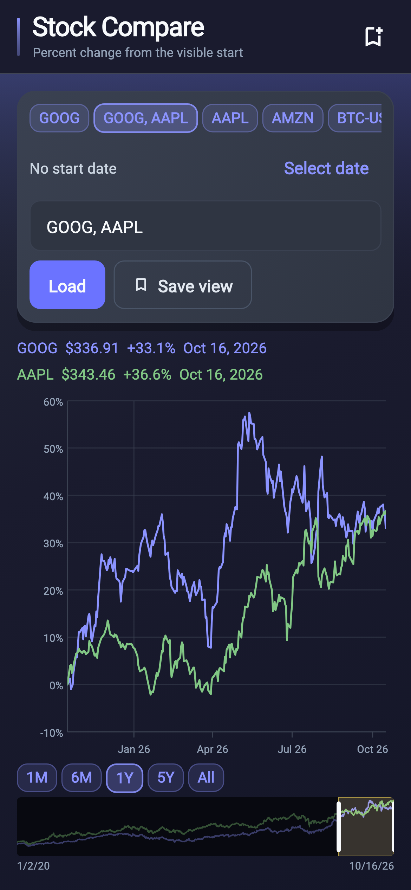
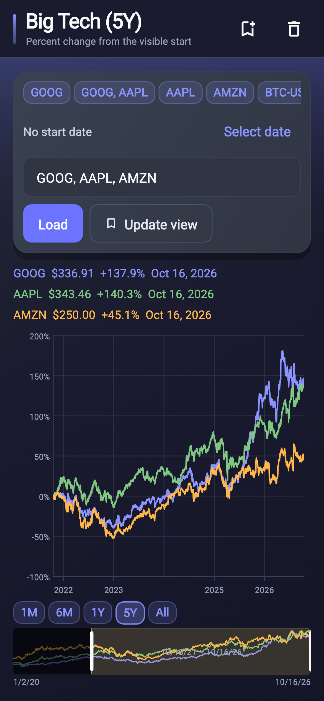
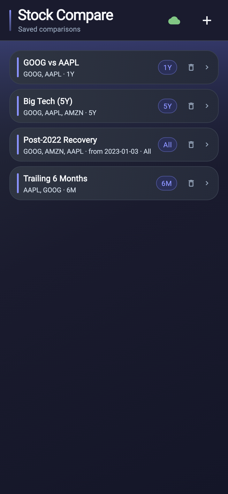

# Stock Compare

Personal **multi-ticker relative stock & crypto comparison** for **macOS and iPhone**. Compare any set of tickers by **percent change from the start of the visible window** (Google Finance rebase style), scrub across full price history, and sync saved comparison views across devices.

### Screenshots

#### GOOG vs AAPL (1Y)



#### Multi-ticker 5Y comparison



#### Saved comparisons



## What it does

- **Rebased percent-change charts** — plots each ticker as `%` change relative to its adjusted close on the first trading day of the visible window, so assets at any price scale can be compared side-by-side.
- **Shared-history alignment** — when comparing tickers with different inception dates, automatically clamps the comparison window to `firstSharedDay` (the latest first-candle date among compared tickers) so every curve begins together at `0%`.
- **Range presets & all-time scrubber** — jump between `1M`, `6M`, `1Y`, `5Y`, and `All` presets or drag/resize the active window over the full historical overview using `EChartAllTimeRangeScrubber`.
- **Synced comparison portfolio** — save named comparison views (ticker list, optional anchor start date, and range preset) that sync across Mac and iPhone via `ethan_sync` (PowerSync + PostgREST + Postgres).
- **Local SQLite candle cache with offline fallback** — stores full daily adjusted-close history per ticker in local-only SQLite tables (`daily_candles`, `ticker_price_fetches`). Same-calendar-day loads resolve instantaneously from SQLite without hitting Yahoo Finance, and offline runs fall back to cached candles.

## How it works

```
Yahoo Finance API ──HTTP──► TickerPriceLoader
                                  │
                                  ▼
           PowerSync SQLite (stock_compare_powersync.db)
           ├── daily_candles & ticker_price_fetches (local-only cache)
           └── comparison_views (synced via ethan_sync ↔ Postgres)
                                  │
                    ┌─────────────┴─────────────┐
                    ▼                           ▼
             PortfolioPage               StockComparePage
          (saved comparisons)        (EChart + range scrubber)
```

1. Opening a saved view (or entering comma-separated tickers like `GOOG, AAPL`) asks `TickerPriceLoader` for each ticker's daily adjusted-close series.
2. `SqliteTickerCandleCache` checks `ticker_price_fetches`: if the ticker was already fetched today, candles are read straight from `daily_candles`. Otherwise, full history is fetched from Yahoo Finance, persisted to SQLite, and sliced to any requested start date.
3. `StockPriceChart` computes `ComparedPriceHistories` (`firstSharedDay` through `lastDay`), rebases each series to `0%` at `visible.start`, and renders interactive `EChart<DateTime>` lines with hover inspection and an `EChartAllTimeRangeScrubber`.
4. Saving or updating a comparison writes to `comparison_views`, which PowerSync uploads through PostgREST to the home-server Postgres database and streams to other devices.

## Code layout

| Path | Role |
|------|------|
| `lib/main.dart` | `ProviderScope`, `SyncLifecycle`, and `MaterialApp` (`ETheme.material3Dark`) |
| `lib/app_identity.dart` | App constants and local PowerSync database filename |
| `lib/sync/` | PowerSync schema (`comparison_views`, `daily_candles`, `ticker_price_fetches`) and `ethan_sync` configuration |
| `lib/model/` | `ComparisonView`, `TickerPriceHistory`, `ComparedPriceHistories`, `TickerPriceLoader`, `VisibleRangePreset` |
| `lib/services/` | `ComparisonViewsDao` and `SqliteTickerCandleCache` |
| `lib/providers/` | Riverpod providers for DAO, candle store, and price loader |
| `lib/ui/pages/` | `PortfolioPage` (saved views home) and `StockComparePage` (chart + ticker controls) |
| `lib/ui/stock_price_chart.dart` | Rebased multi-series `EChart<DateTime>`, preset chips, and all-time range scrubber |
| `db/` | Server-side Postgres migrations, `powersync.yaml` (**8088**), and `infra.yaml` (PostgREST **3011**) |

## Setup

Sibling path packages:

- `../ethan_utils`
- `../ethan_sync`
- `../ethan_ui`

```bash
cd ~/code/my-code/Active/Flutter/stock_compare
cp .env.example .env
# Set SERVER_HOST_LAN, SERVER_HOST_TAILSCALE, and POWERSYNC_JWT_SECRET
flutter pub get
flutter run -d macos
# or
flutter run -d iphone
```

### `.env` keys

| Key | Required | Purpose |
|-----|----------|---------|
| `SERVER_HOST_LAN` | Yes | Home server LAN hostname or IP (`<lan-host-or-ip>`) |
| `SERVER_HOST_TAILSCALE` | Optional | Tailscale hostname or IP for away-from-home sync |
| `POWERSYNC_JWT_SECRET` | Yes | Raw HS256 secret matching `STOCK_COMPARE_POWERSYNC_JWT_KEY` on the server |

### Database migrations

Server schema lives under `db/` (PowerSync port **8088**, PostgREST port **3011**):

```bash
./scripts/migrate.sh migrations/001_initial.sql
# Or full provisioning when powersync.yaml / infra.yaml changes:
./scripts/migrate.sh --full migrations/001_initial.sql
```

### Regenerating README screenshots

Screenshots are generated deterministically from real historical daily candles in `test/readme_screenshot_candles.json`:

```bash
flutter test --update-goldens test/readme_screenshot_generator_test.dart
```
